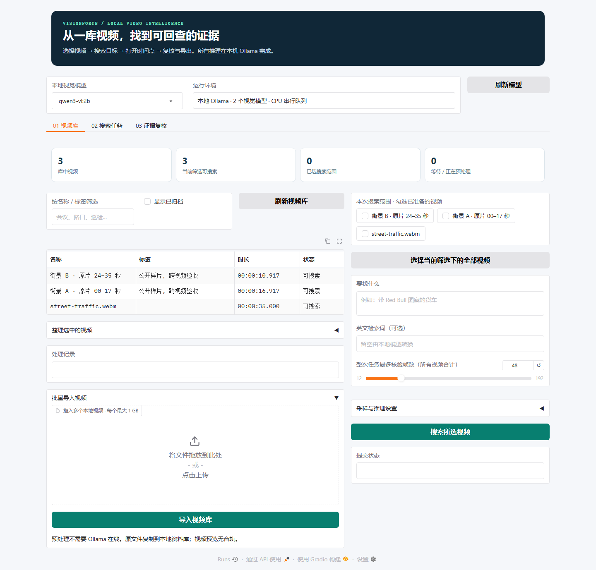

# VisionForge · 机器人状态变化验证与本地视频证据

用一台 Windows / 16 GB / CPU 电脑和本地 Ollama，研究一个可测的问题：**机器人执行子任务后，加入动作前后的视觉变化，是否比只看最终画面更可靠地判断成功或失败？**

当前使用作者公开的 [Guardian UR5-Fail](https://huggingface.co/datasets/paulpacaud/Guardian-FailCoT-OOD-datasets/tree/bd2b24224e4da833a8d42ca694d839622e54bb48/ur5fail_test)：已下载核验140条人工标注的执行验证记录，69条成功、71条失败，覆盖16个基础任务组。每条包含动作前后各3个视角。固定 CLIP 编码器与 scikit-learn 线性分类器用于基础任务组留一验证，本地 Qwen3-VL 用于输入消融；不重新实现预训练模型或训练机器人策略。

[机器人实验协议与错误分析](docs/ROBOT_BENCHMARK.md) · [完整离线报告](artifacts/robot-benchmark/index.html) · [原始指标](artifacts/robot-benchmark/metrics.json) · [视频库使用说明](docs/LIBRARY_WORKFLOW.md)

## 算法比较

| 实验 | 比较与控制 |
|---|---|
| 冻结特征线性分类 | 训练集多数类、只读子任务、只看动作后状态、动作前后变化；按基础任务组逐折留出，共140条预测 |
| 数据泄漏控制 | 每折额外移除与测试基础任务组共享任一图片哈希的训练记录；标准化与拟合只使用当前训练折 |
| 本地 VLM 消融 | 每个基础任务组按固定哈希选1条，16条固定诊断样本；after-only、正确顺序、交换顺序，48次真实调用已完成 |
| 可复算评价 | 全样本分母的 accuracy、balanced accuracy、macro F1、覆盖率、逐类召回、任务宏平均和按任务聚类的置信区间；保留拒答与错误 |

### 本地 VLM 的实测负结果

2026-10-15，固定 `qwen3-vl:2b` 在同一16条样本（8成功、8失败）的三种输入上，**48次均返回有效结构，却全部判断为成功**。每个条件覆盖率100%，失败召回为零；调用成功不等于任务判断正确。

| 输入条件 | 正确 / 全部 | Accuracy / Balanced accuracy | 失败召回 | 成功召回 | Macro F1 |
|---|---:|---:|---:|---:|---:|
| 仅动作后 `after_only` | 8/16 | 50.00% / 50.00% | 0/8 · 0.00% | 8/8 · 100.00% | 33.33% |
| 正确顺序 `ordered` | 8/16 | 50.00% / 50.00% | 0/8 · 0.00% | 8/8 · 100.00% | 33.33% |
| 交换顺序 `reversed`（诊断） | 8/16 | 50.00% / 50.00% | 0/8 · 0.00% | 8/8 · 100.00% | 33.33% |

加入动作前画面没有修正任何判断。交换前后时预测翻转0/16，排除前后图像完全相同的一条后为0/15；`reversed` 相对原标签的分数仅是输入损坏诊断，不是反向执行准确率。这说明**当前2B模型、提示词和拼板协议在此子集上未能检测失败**，不能推广成所有 VLM 的结论。[三条原始误判例](docs/ROBOT_BENCHMARK.md#原始错误例事后选例)展示了错误对象识别和把“夹爪在物体上方”推断为抓取成功的说明。

相同16条上，线性分类器的动作后与前后变化方法均为15/16，失败召回7/8；这是每组仅一条的诊断子集，不能拿93.75%替换下面140条的主成绩。完整逐方法对照见[实验协议](docs/ROBOT_BENCHMARK.md#同一16条诊断子集上的-cv-对照)。

### 已完成的真实 CV 结果

2026-10-15，本机完成全部140条、16折留一基础任务组验证，四种方法覆盖率均为100%。结果来自实际固定 CLIP 特征和逐折预测，没有调用 VLM 为自身结果打分。

| 方法 | 正确 / 全部 | Accuracy | Balanced accuracy | 失败召回 | Macro F1 |
|---|---:|---:|---:|---:|---:|
| 训练折多数类 | 60/140 | 42.86% | 42.54% | 46/71 · 64.79% | 39.71% |
| 仅子任务文本 | 75/140 | 53.57% | 53.63% | 35/71 · 49.30% | 53.51% |
| 仅动作后状态 | 89/140 | 63.57% | 63.70% | 39/71 · 54.93% | 63.35% |
| 动作前后变化 | 95/140 | 67.86% | 68.02% | 40/71 · 56.34% | 67.48% |

前后变化比动作后状态多答对 **6条**：修正13条，同时退步7条；Accuracy 差值 **+4.29个百分点**，按基础任务组配对 bootstrap 的95%区间为 **[-1.32, +9.38]个百分点**，跨越零，不能证明稳定提升。

净增加的6个正确中，成功样本增加5个（50/69 → 55/69），失败样本只增加1个（39/71 → 40/71）。仍漏掉31/71个真实失败，不能把整体准确率提升写成强失败检测能力。

额外检查17对“同样的6张图、不同子任务、相反标签”：动作后和前后变化方法都只有3对同时答对；前后变化方法仍对14对给出相同判断。这个结果不支持已可靠理解指令条件下的动作效果；配对复用部分样本，17对也不是17次独立实验。

这是小样本、基础任务组留一验证的探索实验，不是 Guardian 官方零样本榜单成绩。140条记录复用了部分机器人观测，不能称为140次独立 rollout。交换前后画面只检验顺序敏感性，原标签不是反向执行的真值。

前后变化表示同时增加了特征维度和交互项，成绩差异不能单独归因于时序理解。置信区间对固定折外预测按任务重采样，不涵盖重新训练的方差；完整取舍见[实验协议](docs/ROBOT_BENCHMARK.md)。

基础组只是 `taskvar` 去掉 `+variation` 后缀；叠杯、食物/水果装盒等语义相近任务仍可能跨组。没有精确图片或 episode 重叠不代表语义完全隔离，因此这里也不声称严格的全新任务泛化。

发现这种重叠后，另做一次独立的**四粗组后验压力测试**，首次拟合前冻结唯一映射，保留原16组主表。动作后和前后变化都为82/140（58.57%）；前后变化的失败召回提高到47/71（66.20%），代价是成功召回从动作后方法的46/69降到35/69。原主表前后变化的95/140在粗分组下变为82/140，收益不稳定。四组大小12/25/92/11极不平衡且仍共享抓取动作，不是严格OOD；完整结果、区间和复算见[独立压力测试](docs/ROBOT_BENCHMARK.md#独立后验压力测试四个粗分组)。

**当前验证的是子任务状态转换。** 这份数据没有秒级失败发生时间、连续运动、关节轨迹或控制动作；本项目没有据此完成秒级失败定位、因果诊断或机器人控制。REFLECT 的时间标签和媒体可取得性、CALVIN / LeRobot 等取舍，见[调研记录](docs/ROBOT_BENCHMARK.md#数据选择的调研记录)。

克隆后可以直接打开[主报告](artifacts/robot-benchmark/index.html)，查看[原始48次响应](artifacts/robot-benchmark/predictions)、[逐折预测](artifacts/robot-benchmark/cv.json)和[独立压力测试](artifacts/robot-sensitivity/evaluation.json)。以下两条命令只用 Python 标准库重算已发布预测的指标并核对完整性，无需安装模型、重新推理或联网：

```powershell
python -B tools/verify_robot_release.py artifacts/robot-benchmark
python -B artifacts/robot-sensitivity/verify.py --main-bundle artifacts/robot-benchmark
```

校验值证明文件和结果内部一致，不是作者数字签名，也不证明模型泛化能力。

## 本机运行

```powershell
git clone https://github.com/chendi-Shi/visionforge.git
cd visionforge

# Python 3.12+；先安装并启动本地 Ollama
powershell -ExecutionPolicy Bypass -File .\setup.ps1 -WithSearch

# 安装轻量线性分类器，取得固定版本机器人数据（图像包约78 MiB）
.\.venv\Scripts\python.exe -m pip install -r requirements-robot.txt
.\.venv\Scripts\python.exe tools/fetch_robot_benchmark.py --output data/robotbench

# 固定特征、基础任务组留一验证、本地 VLM 消融、离线报告
.\.venv\Scripts\python.exe -m robotbench.run --data data/robotbench --output data/robot-run features
.\.venv\Scripts\python.exe -m robotbench.run --data data/robotbench --output data/robot-run cv
.\.venv\Scripts\python.exe -m robotbench.run --data data/robotbench --output data/robot-run vlm --model qwen3-vl:2b
.\.venv\Scripts\python.exe -m robotbench.run --data data/robotbench --output data/robot-run report
```

打开本地生成的 `data/robot-run/index.html` 查看逐条件成绩和样本证据；`metrics.json`、`cv.json` 和 `predictions/` 保留指标、逐折划分和原始响应。数据准备、特征和交叉验证不要求 Ollama 在线；VLM 消融需要本地模型。VLM运行计划在首个调用前固定，重复同一命令可以跳过已保存结果；改变数据、模型 digest 或运行设置需使用新输出目录。推理停止后可以为未完成实验生成报告，未回答样本仍计入分母；推理运行时，同目录的 `report` 命令会因互斥锁拒绝执行。

主界面的首个页面为“机器人算法实验”，只读展示 `artifacts/robot-benchmark` 的公开结果：指标、调用进度、六图观测、作者标签和逐方法原判。此页不会启动推理或改变协议；尚未导出时明确显示为空。完整复算仍使用上述命令。

首次安装、模型和数据下载需要网络；特征与 VLM 推理在本机运行，不向在线模型发送图片。`-WithSearch` 会安装搜索依赖及 `qwen3-vl:2b`；第一轮特征提取下载约606 MB固定 CLIP 权重，后续复用 `%LOCALAPPDATA%/VisionForge/models` 缓存。机器人数据与结果默认保存在已忽略的 `data/`，不随 Git 提交。

本项目按 **i5-1130G7 / 16 GB / Iris Xe、CPU** 设计，VLM串行调用，默认用3个视角，不承诺实时。该模型是本机预算下的固定实验对象，不宣称最新或通用最强。历史 Qwen / MiniCPM 四帧诊断保留在[旧实测](docs/SEARCH_VALIDATION.md)，不能作为机器人任务成绩。

本轮通过171项回归测试及 `pip check`。公开 PyPI 的 `--dry-run --no-deps` 检查确认锁定包可获取；这不等于全新环境安装已验证。模型内容成绩以真实样本指标为准。

## 现有视频证据库

视频工作流继续可用：批量导入 → 名称/标签/归档 → 限定搜索范围 → 回到原始画面复核 → 导出离线证据包。视频预处理无需 Ollama 在线，原有单视频 CLI 和 `LibraryEngine` Python 接口继续保留，见[完整说明](docs/LIBRARY_WORKFLOW.md)。

```powershell
# 可选：核验下载公开街景样片；也可以上传自己的视频
.\.venv\Scripts\python.exe tools/fetch_video_sample.py
powershell -ExecutionPolicy Bypass -File .\start.ps1
```

打开 <http://127.0.0.1:7860/>。全批默认最多核验48帧、每视频最多12帧；同一查询分派到各视频独立排序，再汇总证据，目前没有全库统一 Top K。相似度不是概率，稀疏采样的“未见”不等于全视频“没有”；音频不参与判断。服务只监听本机回环地址。作业默认位于 `%LOCALAPPDATA%/VisionForge/video-data`，可用 `VISIONFORGE_DATA_DIR` 更改。旧完整界面 `legacy_app.py` 按需单独启动，不能与主界面同时占用7860端口。



## 已有视频验证与审计

2026-10-15：110 项离线测试通过；同一公开样片的两个独立片段完成跨视频实跑，共 6 次真实本地核验。浏览器验证了跨视频定位；真实 32 秒漏检经过修正、撤销、恢复修正，原始记录哈希保持不变。[报告、界面与验收数据](docs/LIBRARY_VALIDATION.md)。这不是独立数据集准确率评估。

2026-10-13 的单视频中文端到端实测完成10帧及服务重启恢复。**其中仍有真实漏检：模型认出31秒的品牌货车，却漏掉32秒，导致错误的消失区间。** [历史报告、原始响应和错误复核](docs/SEARCH_VALIDATION.md)保持原样公开。本轮新增复核流程能记录纠正并更新当前时间证据，不能据此宣称模型准确率提高。

模型原判和追加式复核历史分别保留，开发助手复核与用户复核分开标记；修改会重算当前时间证据，但不覆盖原始输出。继续执行时复核暂缓应用；输入或模型变化会标记旧复核失效。混合模型身份的结果不合并推导时间区间。复核不会训练模型或纠正未审核的其他样本。

- [视频库、跨视频任务与复核](docs/LIBRARY_WORKFLOW.md)：预算分配、原子提交、复核审计、导出与复用边界。
- [检索架构与复用](docs/SEARCH_REUSE.md)：直接复用 FastEmbed、ONNX Runtime 和固定 CLIP 模型，使用 NumPy 做小规模相似度排序，无需数据库服务。
- [任务与证据架构](docs/SEARCH_ARCHITECTURE.md)：暂停恢复、身份校验、资源互斥及时间区间的推导条件。
- [新版实测与原始记录](docs/SEARCH_VALIDATION.md)：模型对照、真实画面检索、误召回与自动化检查。
- [旧版真实视频验证](docs/VIDEO_VALIDATION.md)与[内容错误复核](docs/VIDEO_CONTENT_REVIEW.md)：保留旧版跨帧误认，不能当成新版成绩。
- [四例固定诊断集](examples/video/grounding-cases.json)：来自同一段公开视频，由助手目视标注，**未经用户审核，不是独立 benchmark**。程序结构通过与内容标签匹配分别报告。

```powershell
.\.venv\Scripts\python.exe -B -m unittest discover -s tests -v
.\.venv\Scripts\python.exe -m pip check
```

旧版完整离线报告仍可在克隆后打开 [report.html](artifacts/video-evidence/0354ceb6ccaf4e3eb7857a7368ff0b67/report.html)。原始 WebM 按需下载，重复的预生成 ZIP 不入 Git。

## 实现入口

|文件|职责|
|---|---|
|robotbench/data.py / tools/fetch_robot_benchmark.py|固定上游版本、核验下载、隔离模型输入与评价标签|
|robotbench/models.py / probe.py|多视角前后输入、固定 CLIP 特征、按基础任务组留一的线性分类与 Ollama 判读|
|robotbench/metrics.py / run.py / report.py|固定实验身份、聚类不确定性、配对比较和逐样本报告|
|video_index.py|完整时间轴采样、CLIP画面索引、缓存校验与时间去重|
|core_grounding.py|单帧可见性核验与相邻采样区间推导|
|search_jobs.py / search_cli.py|持久检索、预算、暂停续跑与模型身份隔离|
|library_jobs.py|视频资料、批量导入、跨视频父子任务与整批预算|
|search_reviews.py|追加式复核历史、证据绑定与时间证据重算|
|app.py / robotbench/ui.py / workbench.py|只读机器人实验入口与视频库、搜索任务、证据复核页面|
|search_report.py / library_report.py|单视频报告和多视频离线证据包|
|legacy_app.py|保留的旧版完整界面，按需单独启动|
|video_media.py / video_jobs.py|视频预处理、已有作业及旧版摘要工作流|
|core.py / core_video.py|共用Ollama客户端及保留的双帧摘要|

项目新增代码使用 [MIT](LICENSE)。依赖、模型与公开样片各自保留许可，见 [THIRD_PARTY.md](THIRD_PARTY.md)；尤其当前 FFmpeg 构建启用 GPL。样片 **Street traffic — Editor，CC BY 3.0，来源 Wikimedia Commons**；帧图和无声预览为衍生产物，完整归属见 [source.json](examples/video/source.json)。公开副本的路径清理与历史记录见 [PUBLICATION.md](PUBLICATION.md)。
