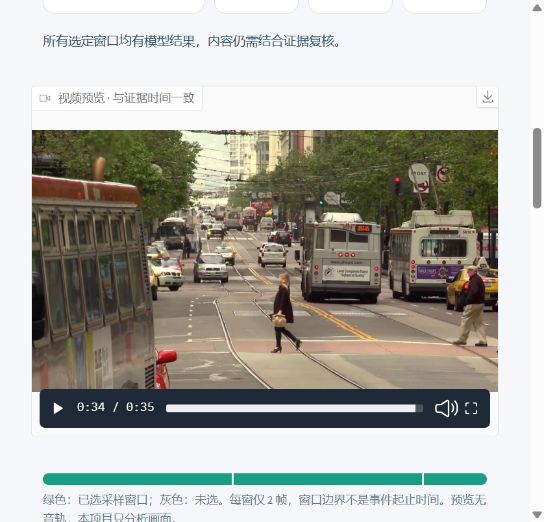

# VisionForge · 本地视频证据工作台

公开仓库：[chendi-Shi/visionforge](https://github.com/chendi-Shi/visionforge)。克隆后按下方说明启动：

```powershell
git clone https://github.com/chendi-Shi/visionforge.git
cd visionforge
```



发布副本中的路径脱敏及证据保留说明见 [PUBLICATION.md](PUBLICATION.md)。


用这台 Windows 笔记本和本地 Ollama，把视频整理成**可检索、可定位、可复核的观察时间线**。上传后先查看抽帧范围，再启动逐段分析；每条观察引用实际证据帧，点击证据可跳到视频中的对应时刻。

已在本机跑完35秒公开街景的三窗六帧，模型耗时约13分50秒，40项离线测试通过。2B模型仍有跨帧对象误认和细节错误，结果按待复核草稿使用，详见[真实验证记录](docs/VIDEO_VALIDATION.md)。

底层直接复用 **FFmpeg + PySceneDetect + Ollama 官方 SDK + Gradio**。项目实现的是作业管理、证据关联和复核工作流，不训练模型，也不重写解码器。GitHub 项目比较、固定版本与许可见 [视频复用取舍](docs/VIDEO_REUSE.md)。

## 已实现的工作流

1. 导入 MP4 / WebM / MOV / MKV / AVI，本地复制保管原视频，计算 SHA256。
2. FFmpeg 创建宽度不超过 960 像素、12 fps 的 H.264 无声预览；PySceneDetect 检测镜头变化，并把长镜头切为最长 15 秒的候选窗口。
3. 按预算均匀选择窗口，保留首尾。每窗在约 20% / 80% 处抽两帧，保存实际解码帧号、时间和哈希。界面展示已选与遗漏的窗口。
4. 每窗两帧按时间顺序送入同一个本地 VLM 请求，输出观察、证据 ID 和不确定之处。结构或证据引用不合法、输出截断均记为失败，保留原始响应。
5. 每段独立落库，可暂停、续跑和重试失败段；成功段复用前核对模型 digest、代码、配置及证据哈希。UI 与 CLI 共享 SQLite 和唯一后台 worker。
6. 按文字筛选时间线，点击采样帧跳转视频；人工确认、修正、排除意见独立保存。
7. 导出含视频、证据图、离线 HTML、JSON、CSV 的 ZIP。解压后直接打开 report.html，即可按帧定位；原文、参数、耗时、失败历史与复核意见保留在 JSON。

**窗口边界是采样范围，不是模型检测的精确事件起止。** 两张图无法证明中间连续动作，也可能漏掉短暂事件。本项目没有音频识别、目标跟踪或向量语义检索；搜索是观察内容与复核记录的文字匹配。

## 本机运行

Python 3.12；本机已安装 Ollama 0.34.4 与 qwen3-vl:2b。首次安装需要联网，此后推理只使用本机地址。

```powershell
# 首次安装完整视频环境；已有环境可跳过
powershell -ExecutionPolicy Bypass -File .\setup.ps1 -WithVideo

# 如需使用公开街景样片，先按官方来源下载并核验大小及 SHA256
.\.venv\Scripts\python.exe tools/fetch_video_sample.py

# 启动视频工作台
powershell -ExecutionPolicy Bypass -File .\start.ps1
```

原始 WebM 为按需下载文件，不随 Git 仓库分发；上传自己的视频无需下载样片。下载器发现正确文件会跳过，发现大小或 SHA256 不符会拒绝覆盖。

打开 <http://127.0.0.1:7860/>。下载样片后可以先点“载入公开街景样片”，检查抽帧后点“开始 / 继续分析”。本机为 i5-1130G7 / 16 GB / Iris Xe，按 CPU 串行推理设计，每段可能数分钟；预算控制的是窗口数量，不是实时处理速度。

UI 默认帧最长边 448、每段最多 512 输出 tokens、4 CPU 线程、4096 上下文。上传上限 1 GB、源视频上限 30 分钟；较长视频仍可能有大量未选窗口。暂停在当前模型请求结束后生效。关闭网页不停止服务；服务退出或电脑重启后，已完成段保留，重新启动后手动继续。

数据默认位于 **%LOCALAPPDATA%/VisionForge/video-data**，与当前 OneDrive 项目目录分开。可在启动前设置 VISIONFORGE_DATA_DIR。原视频、预览、上传缓存、数据库和导出不会自动清理。服务只监听回环地址、关闭统计、不生成公网分享链接，并拒绝云模型或远端模型配置。

## 命令行

```powershell
$env:PYTHONUTF8 = '1'
.\.venv\Scripts\python.exe video_cli.py import examples/video/street-traffic.webm --max-segments 3 --max-tokens 512 --wait
# 上一步返回作业 ID，停在 ready；不会自动运行模型
.\.venv\Scripts\python.exe video_cli.py start YOUR_JOB_ID --wait
.\.venv\Scripts\python.exe video_cli.py pause YOUR_JOB_ID
.\.venv\Scripts\python.exe video_cli.py status YOUR_JOB_ID
.\.venv\Scripts\python.exe video_cli.py list
```

不加 --wait 时后台处理，由文件锁保证一个 worker。分析参数与模型身份属于作业的一部分；修改模型或参数需新建作业，防止不同结果混在同一时间线。

公开验证报告的完整解压资产已保留。克隆后直接用本地浏览器打开 [report.html](artifacts/video-evidence/0354ceb6ccaf4e3eb7857a7368ff0b67/report.html)，即可离线查看已有结果、规范化 MP4 和证据帧，无需下载原始 WebM 或运行模型。重复的预生成 ZIP 不入 Git；工作台的导出功能仍会生成完整 ZIP。

## 验证与架构

- [真实视频验证记录](docs/VIDEO_VALIDATION.md)：样片、真实模型结果、耗时、暂停续跑与已知错误。
- [视频架构](docs/VIDEO_ARCHITECTURE.md)：数据流、作业状态、证据与恢复规则。
- [公开样片来源](examples/video/source.json)：Editor / Street traffic / CC BY 3.0。人工参考观察对应六张固定帧，见 [manual-reference.json](examples/video/manual-reference.json)；不是已由用户复核的标注或公开 benchmark。
- [旧版图片验证记录](docs/VALIDATION.md)保留，不能作为视频理解的成绩。

```powershell
.\.venv\Scripts\python.exe -m unittest discover -s tests -v
.\.venv\Scripts\python.exe -m pip check
```

离线测试验证处理、状态与导出契约，不把 JSON 合法或关键词命中当作视频理解准确率。

## 文件入口

|文件|职责|
|---|---|
|app.py|视频作业库、播放器、时间线、检索与复核|
|video_media.py|FFmpeg 规范化、镜头切分、预算选窗、时间与哈希|
|core_video.py|有序双帧联合推理、观察 Schema、证据引用校验|
|video_jobs.py / video_cli.py|SQLite 持久作业、跨进程 worker、暂停恢复与 CLI|
|video_report.py|可离线使用的证据报告与 ZIP / JSON / CSV|
|core.py|共用图像处理、本地模型限制与 Ollama 客户端|
|image_app.py / run.py / evaluate.py|保留原单图 UI、CLI 与图片评测|
|requirements-video-lock.txt|本机验证的完整视频环境|

旧图片界面可执行 .venv/Scripts/python.exe image_app.py（先退出占用 7860 的视频界面）。原 tools/smoke_ui.py 仅适用于旧图片界面。

新增项目代码使用工作区 MIT 许可。依赖、预训练模型、公开样片各自保留许可证；尤其当前 imageio-ffmpeg 附带的是启用 GPL 的 FFmpeg 构建，详见 [THIRD_PARTY.md](THIRD_PARTY.md)。

