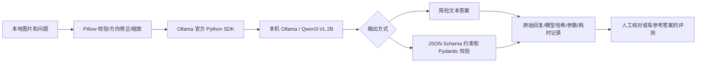

# 这个项目如何工作

核心问题是：**一台没有独显的电脑，能否用本地视觉语言模型完成可复核的图片问答和信息提取？**

VLM 同时接收图片与文字。图片的视觉特征编码、与语言模型的连接以及逐 token 生成都由预训练模型和 Ollama 完成。项目没有手写这些底层组件。应用层的工作是确保图片送给正确的本地模型，限制本机资源使用，并把输出变成可以复核的记录。

## 三种容易混淆的结果

1. **接口成功**：模型返回了完整、非空的内容。它只说明流程通了。
2. **格式正确**：JSON 符合预设字段和类型。它只说明结构可被程序使用。
3. **内容正确**：数量、文字、关系或图表读数与原图相符。这需要参考答案或人工核对，不能用前两项代替。

例如，模型输出 `{"summary":"图中有五个圆形",...}` 可以通过 JSON 校验，但原图可能只有四个。项目保留原始回复，错误答案也进入评测分母，不只统计成功样例。

## 为什么先用小模型

本机只有 16GB 内存和核显。2B 量化模型下载量约 1.9GB，但运行时还需要视觉编码器、中间特征和上下文缓存，不能把下载体积当作峰值内存。项目默认单请求、4 个 CPU 线程、有限的上下文与输出长度。

缩小图片通常能减轻视觉处理负担，但会损失小字和细节。准确性与耗时必须通过同一批图片比较；没有测量前不宣称某个尺寸“最优”。首版没有对实时视频、长文档或多模型并行做承诺。

## 评测设计

`examples/manifest.json` 中的每条记录包含图片、问题和可接受答案。`evaluate.py` 依次推理，并同时保存调用状态、答案、模型 digest、图片哈希、配置与耗时。

严格匹配评分只统一 Unicode、大小写和空白；不自动把一整段解释判作正确数字，也不借助另一个模型替自己评分。开放式描述可以不给参考答案，此时不进入自动准确率分母，需人工核对。

内置的三张程序绘图是功能检查：计数、价格文字、简单柱图。它们不是真实用户数据，不代表公开榜单或泛化准确率。后续真正有价值的工作是收集并标注具体场景的图片，固定题目后比较模型、图片分辨率和提示词。

缓存匹配问题、图片哈希、推理配置、模型 digest 和核心代码 hash；模型更新或代码改变会重新推理。超时、截断或无效 JSON 不复用为成功结果。

## 可复用与新增的边界

复用：Qwen3-VL 模型、Ollama 推理引擎、Ollama Python SDK、Pillow、Pydantic，以及可选 Gradio 界面。

新增：本机场景的参数限制、中文任务、结果记录、失败标记、样例和可续跑评测。项目属于本地多模态应用与评测工程，不能写成“从零训练 VLM”或“自研推理框架”。
