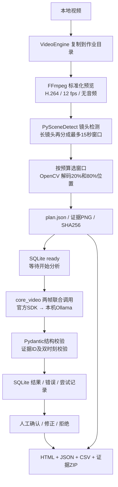
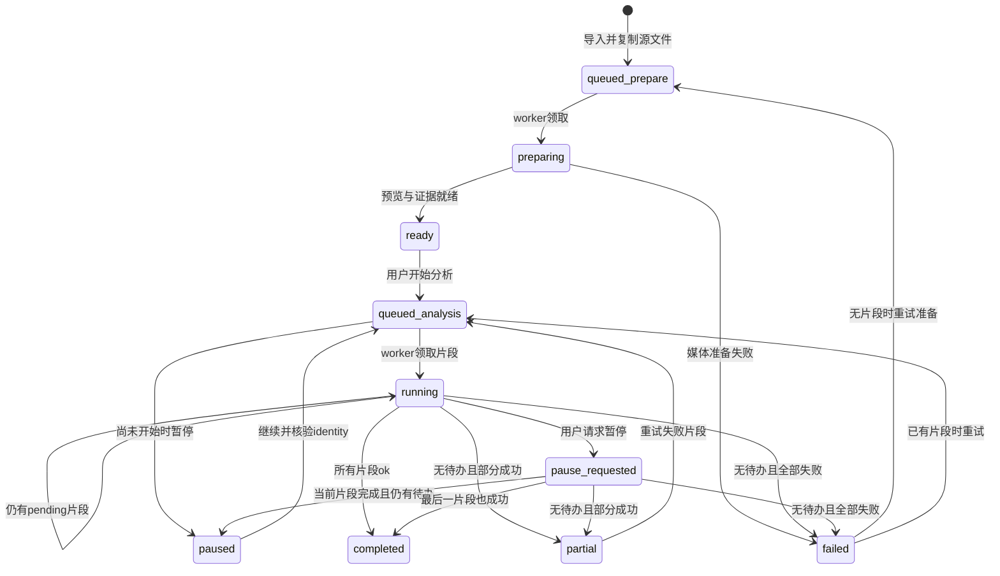

# 视频理解架构

本文按 2026-10-13 的实现整理，描述 [video_media.py](../video_media.py)、[core_video.py](../core_video.py)、[video_jobs.py](../video_jobs.py) 和 [video_report.py](../video_report.py) 的实际职责。依赖取舍与来源见 [VIDEO_REUSE.md](VIDEO_REUSE.md)，许可证见 [THIRD_PARTY.md](../THIRD_PARTY.md)。本文不报告模型准确率或性能成绩。

项目处理的是**本地视频的稀疏画面证据**。媒体层先生成可播放预览、采样窗口和证据帧；用户开始分析后，每窗通常将两帧一起发送给本机 Ollama。模型返回可见状态、变化、文字及不确定性。声音不参与分析，采样窗口也不是事件的精确起止时间。

## 数据流与复用边界

| 层 | 直接复用 | 项目负责的内容 |
| --- | --- | --- |
| `video_media` | imageio-ffmpeg 提供 FFmpeg；PySceneDetect `AdaptiveDetector`；OpenCV 解码、定位和保存 PNG | 输入限制、标准化策略、窗口预算、实际帧号核验、哈希与采样清单 |
| `core_video` | 已有 `core.py` 的本机连接、模型检查、图片准备和推理锁；官方 Ollama SDK；Pydantic | 两帧顺序与提示词、结果结构、证据引用约束、错误和原始响应记录 |
| `video_jobs` | Python SQLite、线程；filelock 跨进程文件锁 | 单 worker、持久任务状态、固定推理身份、继续/重试、尝试历史和人工审阅 |
| `video_report` | Python 标准库的 HTML 转义、CSV、JSON、ZIP 和文件复制 | 可携带证据报告、播放器时间定位、人工修正展示与原始结果并存 |

没有训练视频模型，也没有实现编解码器、场景检测算法或推理引擎。

## 媒体准备：时间戳先于模型

`prepare_video` 接受非空、最多 1 GiB、时长不超过 30 分钟的本地视频。FFmpeg 读取视频流信息，随后生成 `preview.mp4`：时间从零开始，固定 12 fps，宽度最多 960 像素且不放大小图，保持比例，以 H.264 / yuv420p 编码。音频、字幕和数据流被移除。

预览缓存保存在同一作业目录内。复用时检查源视频 SHA-256、标准化配置和预览 SHA-256，并实际解码预览首尾帧。准备流程继续完整解码做场景检测，解码不完整会失败。只有完整扫描后才记录可复用的 `preview-info.json`；JSON 和图片通过临时文件替换写入。

场景检测采用 `AdaptiveDetector`，启用自动降采样，最短场景为 12 帧；无切镜头时保留整个场景。检测边界构成候选时间区间，超过 15 秒的长区间继续切分，所有候选窗口覆盖标准化预览。镜头切换只是采样依据，不是语义事件标签。

`max_segments` 范围为 2–12，默认 4。候选数未超预算时全部采用；超预算时保留首尾窗口，其余按经过时间的均匀目标选取最近窗口中心，避免密集剪辑段占满预算。`selection.all_windows` 明确记录哪些候选被选中以及遗漏数量。

每个选中窗口取其有效帧范围约 20% 和 80% 处的帧号。帧号去重，因此极短窗口可能只有一张图。OpenCV seek 后核验实际返回帧号必须与请求相同；实际时间为 **标准化预览实际帧号 / 12**，记录到六位小数。证据记录包含 `id、time_seconds、frame_index、path、sha256`，窗口记录另存起止范围。

这里没有用原视频名义 FPS 直接计算证据时间。例如公开样片原 WebM 的元数据包含 `1k fps`，而实际计划使用经过核验的 12 fps 预览。界面和报告定位应沿用该预览的时间基；标准化帧时间不等于原始可变帧率视频的每个原始 PTS。

## 本机两帧 VLM 调用

`analyze_segment` 校验 1–2 个有序、有限且非负的时间戳和唯一帧 ID。图片由 `core._prepare_image` 解码、缩放，输入 PNG 的哈希必须匹配计划记录。视频默认最长边为 448 像素，可设 224–768；默认输出上限 384 tokens，可设 128–1024。

一次 `client.chat` 的同一条用户消息包含该窗口的两张图片，并明确图片顺序、证据 ID 和应用提供的时间戳。连接复用 `core.py`，固定为 `http://127.0.0.1:11434`，只接受本地视觉模型。默认模型为 `qwen3-vl:2b`；调用设置 `num_ctx=4096、num_thread=4、temperature=0、think=False`，保活两分钟。对于声明 thinking 能力的 `qwen3vl` 模型，代码追加关闭思考区的 assistant 前缀，避免当前本地版本把答案放入 thinking 区。

JSON Schema 要求摘要、最多三条观察及最多三条不确定性。观察类别为“状态 / 变化 / 文字”，每条必须引用输入证据 ID；重复或不存在的 ID 不通过校验。“变化”必须同时引用两个不同采样时刻。一帧窗口只能给出单帧支持的内容。

结构或引用校验失败记为 `invalid_output`；达到输出上限记为 `truncated`；网络或模型错误由任务层记录为失败。原始响应、结构化结果、提示词、模型 digest、参数、耗时及 Ollama 返回指标都会保留。**结构和引用校验只能验证格式与引用关系，不能证明模型识别的物体或变化正确。**

## 持久状态与串行执行

默认数据目录为 `%LOCALAPPDATA%/VisionForge/video-data`，可用 `VISIONFORGE_DATA_DIR` 指定。每个任务拥有自己的源视频副本、预览、计划和帧目录；`jobs.sqlite3` 的 `jobs、segments、attempts` 分别保存任务、窗口和已返回的推理尝试。SQLite 使用 WAL、外键和事务。

同一数据目录只有持有 `worker.lock` 的进程运行视频 worker；其他客户端可以提交或读取。worker 按创建时间取任务，逐窗串行分析。`core._INFERENCE_LOCK` 还让同一进程中的图片与视频调用串行。它们不限制用户在其他应用里自行发起的 Ollama 调用。

单片段状态为 `pending → running → ok / failed`。一个片段失败后，worker 仍处理剩余待办，最后汇总为 `completed、partial` 或 `failed`。暂停不强行截断正在进行的模型请求；当前片段返回后保存结果，再按剩余待办决定状态。`completed` 表示所有采样片段运行成功，不代表已经人工确认。

worker 启动时将中断的 `running` 片段恢复为 `pending`，将运行中的任务设为 `paused`，由用户决定是否继续；中断的媒体准备重新进入 `queued_prepare`。这些行为让界面关闭或进程重启后的任务进展可以从 SQLite 恢复。

## identity 与成功结果复用

这是**同一任务内的持久结果复用**，并非跨任务共享的全局语义缓存。首次开始分析固定以下 identity：

- 解析后的本地模型名称与 digest；
- `core.py`、`core_video.py` 文件的 SHA-256；
- 排序序列化后的任务配置 SHA-256，配置包括关注问题、模型、帧预算、图片尺寸和输出预算。

继续或重试前重新计算 identity，任何字段不同都会要求新建任务，防止混合模型或代码版本。已经 `ok` 的片段先核验其证据文件哈希，缺失或变化则拒绝复用。每次真实调用返回的 digest 也必须匹配固定 identity，且状态为 `ok`、摘要非空，才把片段记为成功。

重试只把失败片段恢复为 `pending`；已成功片段保留。`attempts` 记录每次已完成调用的返回结果与错误，因此后来的成功结果不会抹去之前的失败记录。媒体层另有源文件与标准化配置约束下的预览复用，两种复用机制职责不同。

## 人工复核与导出

每个片段的审阅状态独立存储为 `unreviewed、confirmed、corrected、rejected`。修正必须提供非空文字；`corrected` 的文字成为展示摘要，模型原始摘要、观察、原始响应与尝试记录保留。确认或拒绝不会改写原始输出，也不会把机器失败自动变成成功。

`export_job` 每次创建独立导出目录，生成 `evidence.json、timeline.csv、report.html` 和 `video-review.zip`。ZIP 包含规范化 H.264 预览与证据图片；预览复制前后均校验 preview_sha256，缺失或变化则拒绝导出，HTML 不依赖外部脚本或模型服务。JSON 带配置、identity、采样选择、模型结果、尝试历史、人工审阅及资源清单；CSV 并列展示当前摘要与模型原摘要；HTML 可点击帧和时间定位视频。

导出检查图片是否存在，重新计算复制后图片的哈希；与原记录不同会写入明确警告，缺失图片则拒绝导出。报告对正文做 HTML 转义，对 CSV 的公式前缀作保护。导出阶段不调用模型，也不把人工修正悄悄写回模型结果。

用于目视对照的公开样片、正式三窗六帧及独立参考见 [manual-reference.json](../examples/video/manual-reference.json)。该参考由助手目视整理、尚未经用户人工复核；不能据此直接宣称完整视频识别准确率。
